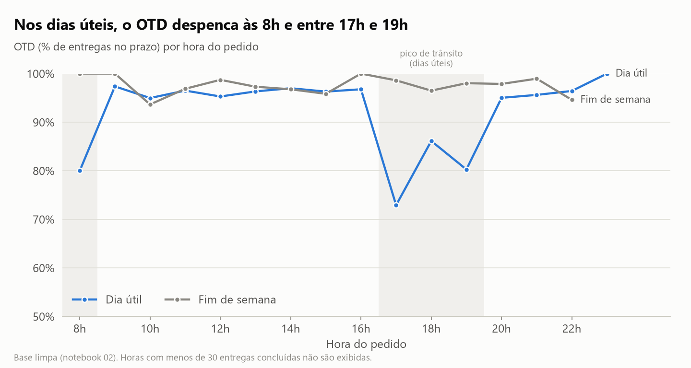
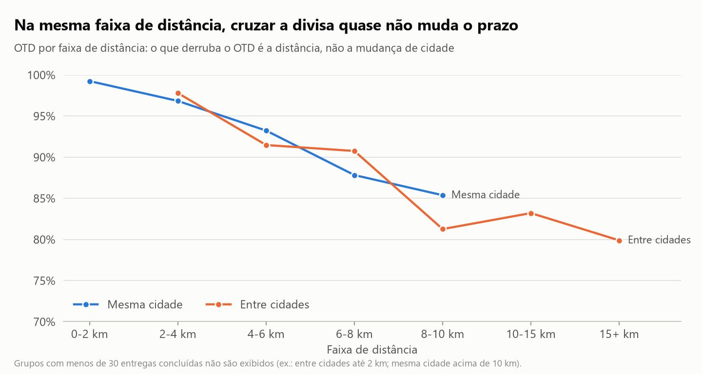
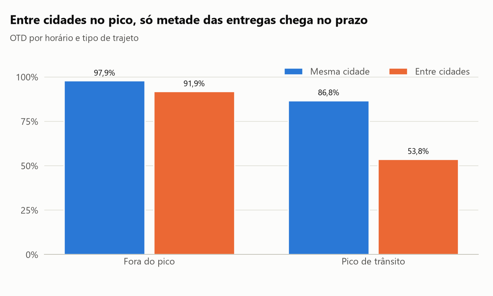

# Logística e Rotas Inteligentes

Projeto de portfólio em análise de dados sobre desempenho de entregas, tempos de trânsito, eficiência operacional e otimização de rotas.

Base simulada de entregas de moto no ABC paulista (Santo André, São Bernardo do Campo, São Caetano do Sul, Diadema) e em Mauá, com bairros e vias reais. Pedidos, tempos e posições dos bairros são simulados.

> Status: exploração, limpeza, análise de desempenho e dashboard prontos. Próximo: mapas e roteirização.

## Principais resultados

**1. O trânsito, e não a demanda, derruba o prazo.** Nos dias úteis, o OTD cai de 96,0% para 80,7% no pico (8h e 17h às 19h). No fim de semana, sem pico, fica em 97,7%.



**2. Entregas entre cidades atrasam mais por serem longas, e não por cruzarem a divisa.** No geral, o OTD é de 85,2% entre cidades e de 95,6% na mesma cidade. Comparando faixas de distância iguais, as duas linhas andam juntas.



**3. Pico e distância se somam.** Só 53,8% das entregas entre cidades no pico chegam no prazo. A regra de prazo cresce com a distância, mas ignora o horário.



Mais gráficos em [`reports/figures/`](reports/figures/) e no notebook `03_desempenho.ipynb`. *Dados simulados: os resultados mostram o método, não uma operação real.*

## Perguntas de negócio
- Quais rotas e regiões concentram atrasos?
- Qual o tempo de trânsito por trecho e período?
- Onde estão as ineficiências de custo e ocupação?
- Quanto uma roteirização otimizada reduziria distância e tempo?

## Tecnologias
Python, pandas, numpy, matplotlib, seaborn, plotly, geopandas, folium, OR-Tools, Jupyter, pytest.

## Estrutura
```
data/        raw -> interim -> processed (+ external)
notebooks/   análises numeradas
src/         código reutilizável (pacote logistica_rotas)
reports/     relatório e figuras
docs/        dicionário de dados e decisões
tests/       testes automatizados
```

## Como rodar
```bash
python -m venv .venv
.venv\Scripts\activate        # Windows
pip install -r requirements.txt
jupyter lab
```

## Notebooks
1. `01_analise_exploratoria_logistica.ipynb` - visão geral da base, cidades, bairros, pico e entregas entre cidades.
2. `02_limpeza.ipynb` - regra de outlier de tempo validada com gabarito; gera as bases `interim` e `processed` (Parquet).
3. `03_desempenho.ipynb` - OTD por horário, trajeto e cidade; separa o efeito da distância do efeito de cruzar a divisa; gera as figuras do relatório.

## Testes
```powershell
.venv\Scripts\python.exe -m pytest
```

## Dashboard interativo (Streamlit)
```powershell
.venv\Scripts\python.exe -m streamlit run app.py
```
Abre em `http://localhost:8501`. Filtros por status, cidade e bairro, KPIs (entregas, taxa de atraso, tempo médio, cancelamento, valor médio) e gráficos por status, bairro, faixa de distância e hora do pedido.

## Autoria
Molina - estudante de Análise e Desenvolvimento de Sistemas.
