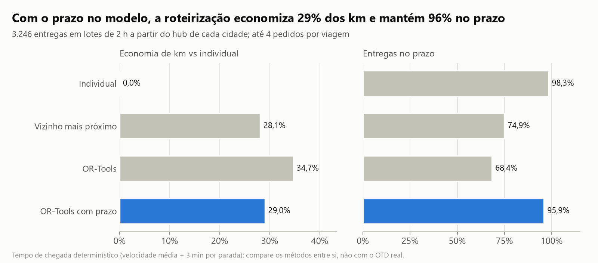
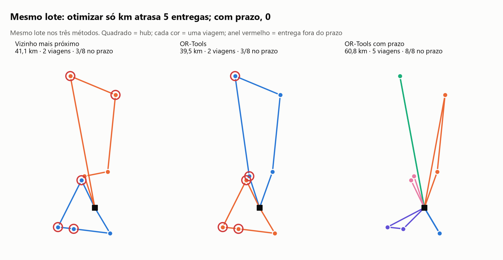
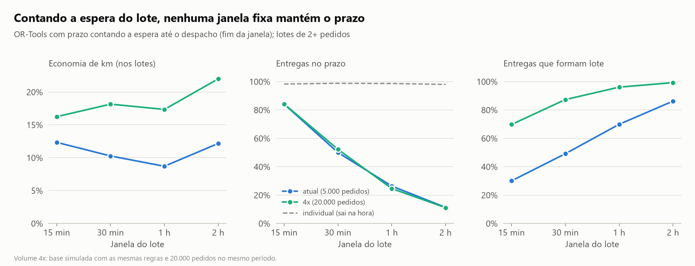
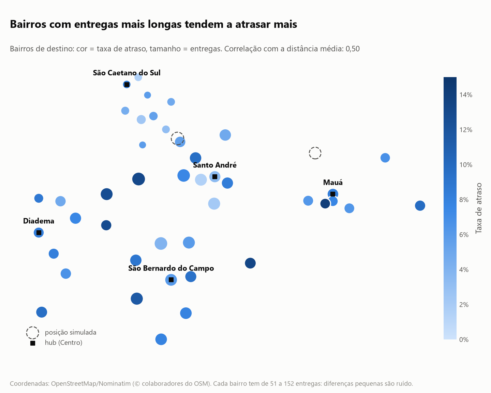

# Logística e Rotas Inteligentes

Projeto de portfólio em análise de dados sobre desempenho de entregas, tempos de trânsito, eficiência operacional e otimização de rotas.

Base simulada de entregas de moto no ABC paulista (Santo André, São Bernardo do Campo, São Caetano do Sul, Diadema) e em Mauá, com bairros e vias reais e bairros geocodificados pelo OpenStreetMap. Pedidos, tempos e valores são simulados.

> Status: exploração, limpeza, desempenho, mapas, roteirização, sensibilidade e dashboard prontos. Próximo: despacho dinâmico.

## Principais resultados

**1. O trânsito, e não a demanda, derruba o prazo.** Nos dias úteis, o OTD cai de 95,9% para 77,6% no pico (8h e 17h às 19h). No fim de semana, sem pico, fica em 96,9%.


**2. Entregas entre cidades atrasam mais por serem longas, e não por cruzarem a divisa.** No geral, o OTD é de 84,1% entre cidades e de 94,8% na mesma cidade. Comparando faixas de distância iguais, as duas linhas andam juntas.


**3. Pico e distância se somam.** Só 51,4% das entregas entre cidades no pico chegam no prazo. A regra de prazo cresce com a distância, mas ignora o horário.


**4. Roteirizar com o prazo no modelo economiza 29% dos km e mantém 96% no prazo - como teto teórico.** Comparando lotes de 2 h a partir de um hub por cidade: otimizar só a distância economiza mais (34,7%), mas derruba as entregas no prazo para 68,4%.





**5. Mas, contando a espera do lote, nenhuma janela fixa mantém o prazo.** O teto acima supõe que os pedidos da janela já estão todos disponíveis. Contando a espera até o lote fechar, mesmo uma janela de 15 min derruba as entregas em lote para cerca de 84% no prazo (contra 98,8% saindo na hora), e 4 vezes mais volume não resolve. O estudo de sensibilidade também mostrou que uma penalidade de atraso de 10 a 30 km/min mantém cerca de 98% no prazo com 29% de economia, e que mais de 4 pedidos por moto não traz ganho. Próximo passo: despacho dinâmico.



**6. No mapa, bairros com entregas mais longas tendem a atrasar mais** (bairros geocodificados pelo OpenStreetMap). Mapa interativo em `reports/mapa_bairros.html`.



Mais gráficos em [`reports/figures/`](reports/figures/) e nos notebooks. *Dados simulados: os resultados mostram o método, não uma operação real.*

## Perguntas de negócio
- Quais rotas e regiões concentram atrasos?
- Qual o tempo de trânsito por trecho e período?
- Onde estão as ineficiências de custo e ocupação?
- Quanto uma roteirização otimizada reduziria distância e tempo?

## Tecnologias
Python, pandas, numpy, matplotlib, seaborn, plotly, geopandas, folium, OR-Tools, Jupyter, pytest.

## Estrutura
```
data/        raw -> interim -> processed (+ external)
notebooks/   análises numeradas
src/         código reutilizável (pacote logistica_rotas)
reports/     relatório e figuras
docs/        dicionário de dados e decisões
tests/       testes automatizados
```

## Como rodar
```bash
python -m venv .venv
.venv\Scripts\activate        # Windows
pip install -r requirements.txt
jupyter lab
```

## Notebooks
1. `01_analise_exploratoria_logistica.ipynb` - visão geral da base, cidades, bairros, pico e entregas entre cidades.
2. `02_limpeza.ipynb` - regra de outlier de tempo validada com gabarito; gera as bases `interim` e `processed` (Parquet).
3. `03_desempenho.ipynb` - OTD por horário, trajeto e cidade; separa o efeito da distância do efeito de cruzar a divisa; gera as figuras do relatório.
4. `04_mapas.ipynb` - qualidade da geocodificação (43 de 45 bairros), checagem de coordenadas e mapas estático e interativo.
5. `05_roteirizacao.ipynb` - individual x vizinho mais próximo x OR-Tools x OR-Tools com prazo em 761 lotes; troca entre km e prazo.
6. `06_sensibilidade_rotas.ipynb` - sensibilidade da penalidade, da capacidade e da janela do lote (contando a espera), em dois volumes de demanda.

## Créditos de dados
Coordenadas dos bairros e mapa de fundo: © colaboradores do [OpenStreetMap](https://www.openstreetmap.org/copyright), licença ODbL, consultados via Nominatim respeitando a política de uso (1 consulta/s, cache local).

## Testes
```powershell
.venv\Scripts\python.exe -m pytest
```

## Dashboard interativo (Streamlit)
```powershell
.venv\Scripts\python.exe -m streamlit run app.py
```
Abre em `http://localhost:8501`. Filtros por status, cidade e bairro, KPIs (entregas, taxa de atraso, tempo médio, cancelamento, valor médio) e gráficos por status, bairro, faixa de distância e hora do pedido.

## Autoria
Molina - estudante de Análise e Desenvolvimento de Sistemas.
