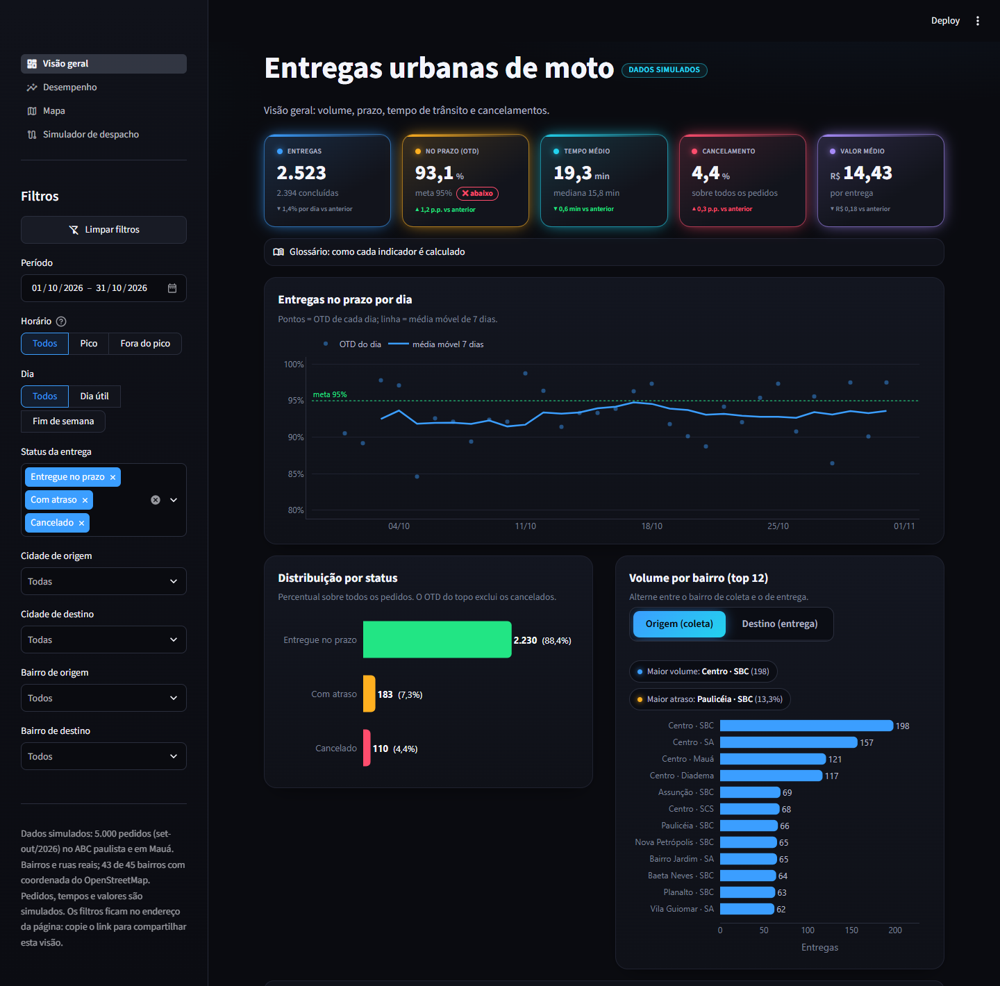
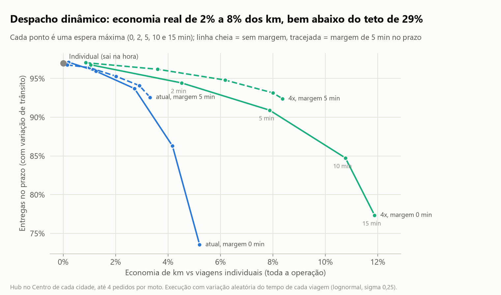
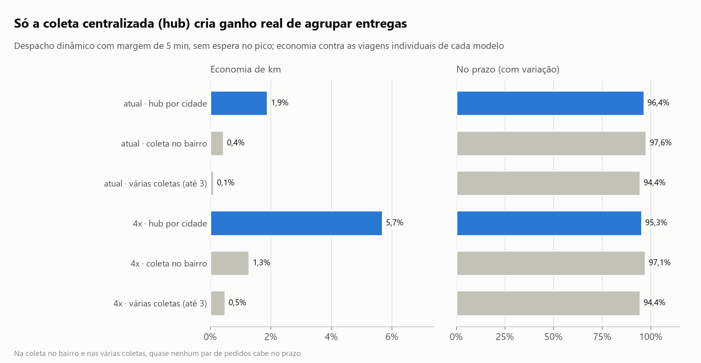

# Entregas de moto no ABC paulista: onde o prazo falha e quanto a roteirização realmente economiza

Projeto de portfólio em análise de dados e otimização logística. Parte de uma base de 5.000 entregas de moto em Santo André, São Bernardo do Campo, São Caetano do Sul, Diadema e Mauá e responde duas perguntas de negócio:

1. **Por que as entregas atrasam?**
2. **Agrupar pedidos numa mesma viagem compensa - e em que condições?**

`Python` · `pandas` · `matplotlib` · `Plotly` · `Streamlit` · `OR-Tools` · `OpenStreetMap / Nominatim` · `OSRM` · `pytest`

> **Sobre os dados:** os pedidos, tempos e valores são **simulados** com regras explícitas (seed fixa). Os municípios, bairros e vias são reais; 43 dos 45 bairros têm coordenada do OpenStreetMap, e a distância pela rua foi medida com o OSRM. Os números mostram o **método**, não uma operação real.



## Resumo

- **O trânsito derruba o prazo, não a demanda.** No pico (8h e 17h às 19h dos dias úteis), as entregas no prazo caem de 95,9% para 77,6%.
- **Entregas entre cidades atrasam por serem longas, não por cruzarem a divisa.** Comparando entregas da mesma faixa de distância, a diferença desaparece.
- **A otimização "de livro" promete 29% de economia de km; a realista entrega de 2% a 6%.** O teto supõe que os pedidos já estão todos disponíveis. Decidindo pedido a pedido, com o prazo no modelo, o ganho é bem menor.
- **O que cria ganho é centralizar a coleta, não o algoritmo.** Só com um hub por cidade agrupar entregas compensa. Com coleta espalhada por restaurante, a economia fica abaixo de 1%.

## Principais achados

### 1. O trânsito, e não a demanda, derruba o prazo
Almoço e jantar têm mais pedidos, mas o OTD (% de entregas no prazo) só cai nos horários de pico de trânsito dos dias úteis. No fim de semana, nos mesmos horários, não há queda.


### 2. Correlação não é causa: a distância explica o atraso entre cidades
No geral, entregas entre cidades têm 84,1% no prazo, contra 94,8% dentro da mesma cidade. Mas, dentro de cada faixa de distância, as duas linhas andam juntas: elas atrasam porque são mais longas. Monitorar o desempenho só por cidade confundiria composição com desempenho.


### 3. Da economia teórica à realista
- **Teto teórico:** com lotes de 2 horas e OR-Tools com penalidade de atraso, a economia chega a 29% dos km com 96% no prazo.
- **Contando a espera:** quando se conta a espera até o lote fechar, nenhuma janela fixa mantém o prazo.
- **Despacho dinâmico:** a moto só espera enquanto o prazo de todos permite, com margem de 5 min e sem espera no pico. A economia é de 1,9% no volume atual e de 5,7% com 4 vezes o volume, perdendo menos de 2 pontos de prazo na rua (0,6 e 1,7 ponto).



### 4. Centralizar a coleta é o que viabiliza agrupar
Foram comparados três modelos de coleta: hub por cidade, coleta no bairro e várias coletas na mesma viagem. Só o hub gera economia relevante. Sem centralização, quase nenhum par de pedidos cabe no prazo, e a melhor política é despachar na hora. A pergunta antes de investir em algoritmo é operacional: **dá para concentrar a coleta?**



Todos os 10 achados, com os gráficos, estão em [`docs/resultados_detalhados.md`](docs/resultados_detalhados.md).

## Método

| Etapa | O que foi feito | Notebook |
|---|---|---|
| Dados | Simulação com regras explícitas; bairros geocodificados (Nominatim) | 01, 04 |
| Limpeza | Regra de outlier de tempo **validada com gabarito**: a simulação permite saber quais registros estão errados | 02 |
| Desempenho | KPIs (OTD, atraso, tempo mediano); comparação dentro de faixas de distância para separar causa de composição | 03 |
| Mapas | Mapa estático e interativo (folium) por bairro | 04 |
| Roteirização | Individual x vizinho mais próximo x OR-Tools x OR-Tools com prazo em 761 lotes | 05 |
| Sensibilidade | Penalidade, capacidade e janela, contando a espera; dois volumes de demanda | 06 |
| Despacho dinâmico | Decisão pedido a pedido; prazo planejado e com variação de trânsito | 07, 08 |
| Distância real | Fator de tortuosidade medido com o OSRM e impacto nas conclusões | 09 |
| Coleta múltipla | Várias coletas na mesma viagem (pickup and delivery) | 10 |

O código reutilizável fica em `src/logistica_rotas/`, e os notebooks só orquestram. Os 50 testes automatizados (`tests/`) cobrem KPIs, limpeza, roteirização, despacho e o dashboard.

## Dashboard
O dashboard tem quatro páginas, com filtros compartilhados na barra lateral: período, horário (pico), dia útil, status, cidade e bairro. Os filtros ficam no endereço da página, então um link copiado abre a mesma visão.
- **Visão geral:** KPIs com meta de OTD (95%) e variação contra o período anterior, OTD por dia, status e volume por bairro, além de um glossário dos indicadores.
- **Desempenho:** OTD por faixa de distância (mesma cidade x entre cidades), atraso por hora e entregas por faixa.
- **Mapa:** bairros no mapa, coloridos por atraso, volume ou tempo.
- **Simulador de despacho:** escolha a espera máxima, a margem, a regra de pico, o volume e o modelo de coleta, e veja a economia de km e o prazo na curva de troca.

## O que mudou ao longo do projeto
Três resultados iniciais foram revistos quando a análise ficou mais rigorosa. Todas as revisões estão registradas no [dicionário de dados](docs/dicionario_dados.md).

- **Regra de outlier:** a primeira regra (velocidade < 3 km/h) marcava 32 entregas corretas como erro. Validada com gabarito, foi trocada por "tempo > 3x a mediana da mesma faixa de distância", que acerta os 32 erros propositais com 2 falsos positivos.
- **Economia da roteirização:** os 29% iniciais eram um teto teórico. O estudo de sensibilidade mostrou o efeito da espera, e o despacho dinâmico chegou ao valor realista.
- **Distância:** o fator 1,3 (linha reta para rua) foi medido com o OSRM: o real é 1,37, e 1,71 em trechos curtos. As conclusões se mantiveram.

## Limitações
- Pedidos, tempos e prazos são simulados; as relações refletem as regras do gerador.
- Velocidade média fixa (normal ou pico); sem tempo de preparo do pedido; frota ilimitada.
- Distância entre centros de bairro (OSRM) e, por pedido, linha reta multiplicada por um fator.

## Como rodar
```powershell
python -m venv .venv
.venv\Scripts\activate
pip install -r requirements.txt

.venv\Scripts\python.exe -m jupyter lab            # notebooks
.venv\Scripts\python.exe -m streamlit run app.py   # dashboard (http://localhost:8501)
.venv\Scripts\python.exe -m pytest                 # testes
```
No Windows com Smart App Control ligado, use `python -m <pacote>`, porque os atalhos `.exe` dos pacotes podem ser bloqueados. Pelo mesmo motivo, `pyarrow` e `ortools` estão fixados em versões que o Windows aceita.

## Estrutura
```
data/         raw -> interim -> processed; external/ (caches do OpenStreetMap e do OSRM)
notebooks/    01 a 10, na ordem da análise
src/          pacote logistica_rotas (ingestao, limpeza, metricas, roteirizacao, visualizacao)
reports/      figuras (PNG) e mapas interativos (HTML)
docs/         dicionário de dados, decisões e resultados detalhados
tests/        testes automatizados (pytest)
app.py        dashboard Streamlit (navegação e filtros)
paginas/      páginas do dashboard
```

## Créditos de dados
- Coordenadas dos bairros e mapas: © colaboradores do [OpenStreetMap](https://www.openstreetmap.org/copyright), licença ODbL, consultados via Nominatim (1 consulta/s, cache local).
- Distâncias pela malha viária: [Project OSRM](https://project-osrm.org/) (servidor público de demonstração; uma única consulta, cache local).

## Autoria
Molina - estudante de Análise e Desenvolvimento de Sistemas.
