# Resultados detalhados

Todos os achados do projeto, na ordem em que foram obtidos. O resumo está no [README](../README.md); cada resultado tem o notebook correspondente em `notebooks/`.

> Dados simulados: os resultados mostram o método, não uma operação real.

**1. O trânsito, e não a demanda, derruba o prazo.** Nos dias úteis, o OTD cai de 95,9% para 77,6% no pico (8h e 17h às 19h). No fim de semana, sem pico, fica em 96,9%.

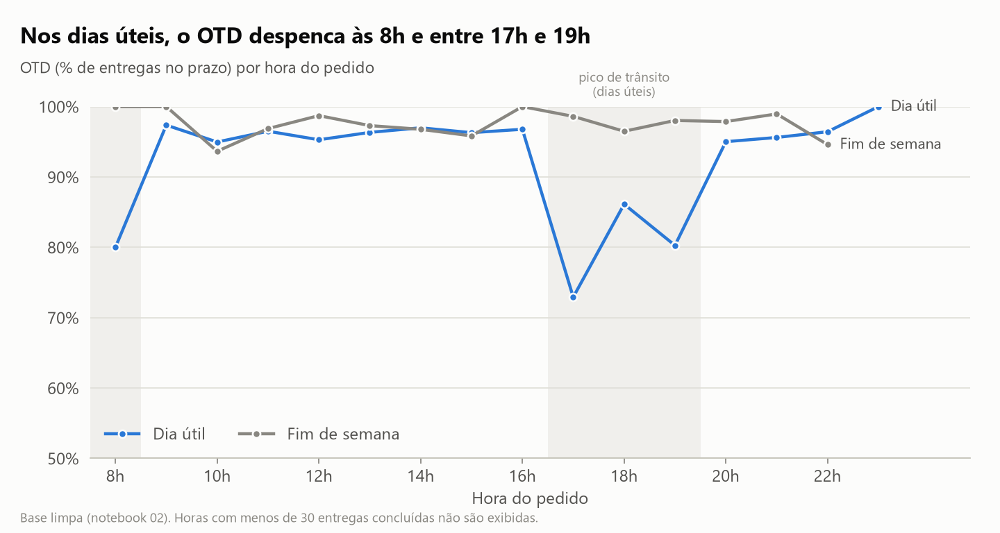

**2. Entregas entre cidades atrasam mais por serem longas, e não por cruzarem a divisa.** No geral, o OTD é de 84,1% entre cidades e de 94,8% na mesma cidade. Comparando faixas de distância iguais, as duas linhas andam juntas.

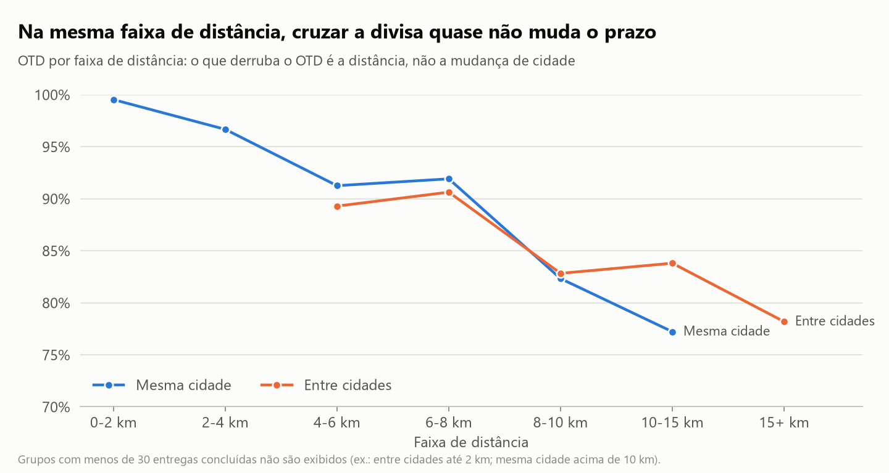

**3. Pico e distância se somam.** Só 51,4% das entregas entre cidades no pico chegam no prazo. A regra de prazo cresce com a distância, mas ignora o horário.

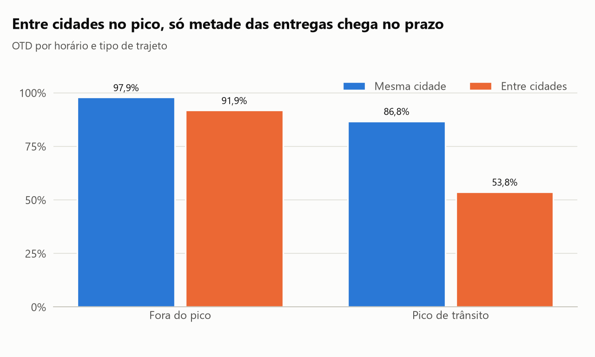

**4. Roteirizar com o prazo no modelo economiza 29% dos km e mantém 96% no prazo - como teto teórico.** Comparando lotes de 2 h a partir de um hub por cidade: otimizar só a distância economiza mais (34,7%), mas derruba as entregas no prazo para 68,4%.

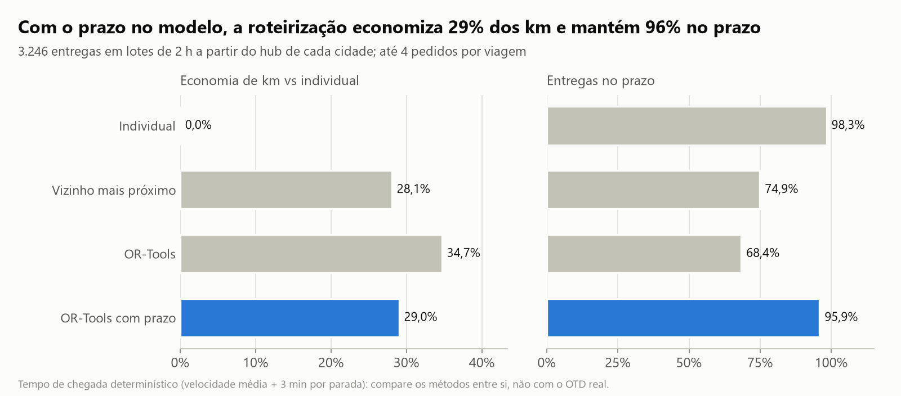

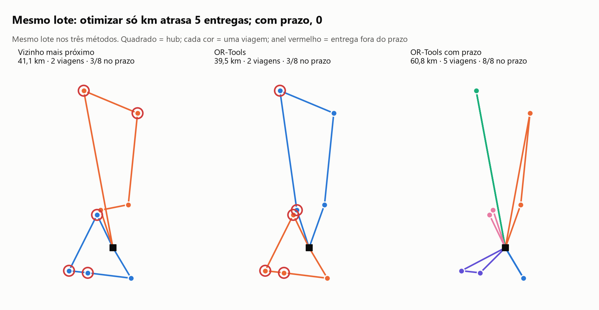

**5. Mas, contando a espera do lote, nenhuma janela fixa mantém o prazo.** O teto acima supõe que os pedidos da janela já estão todos disponíveis. Contando a espera até o lote fechar, mesmo uma janela de 15 min derruba as entregas em lote para cerca de 84% no prazo (contra 98,8% saindo na hora), e 4 vezes mais volume não resolve. O estudo de sensibilidade também mostrou que uma penalidade de atraso de 10 a 30 km/min mantém cerca de 98% no prazo com 29% de economia, e que mais de 4 pedidos por moto não traz ganho.

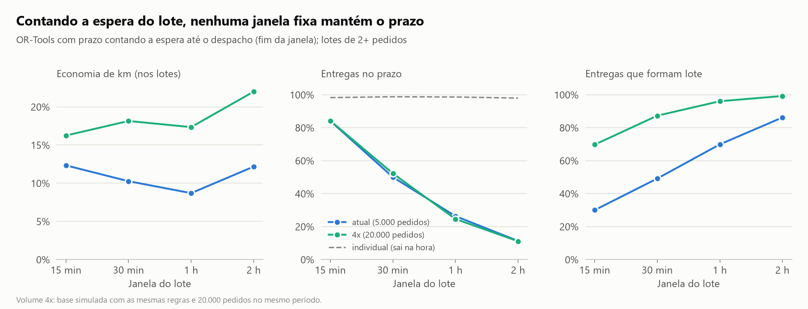

**6. Com despacho dinâmico, a economia realista é de 2% a 8% dos km.** Decidindo pedido a pedido (a moto só espera enquanto o prazo permite, com margem de 5 min), o prazo planejado fica intacto. No volume atual, porém, a economia é de só 1% a 3%, e chega a 4% a 8% com 4 vezes o volume, perdendo de 1 a 5 pontos de prazo na rua. No pico, quase não há ganho: a regra prática é não esperar no pico.

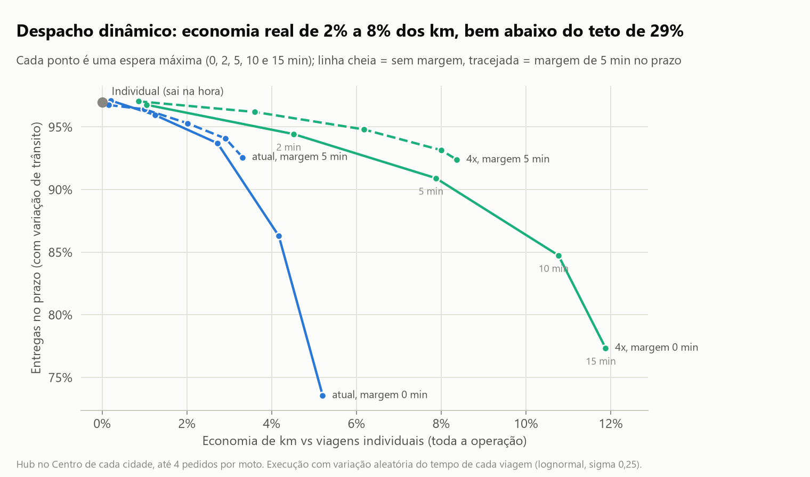

**7. O ganho vem da centralização da coleta, não do algoritmo.** Não esperar no pico quase não custa economia (1,9% contra 2,0%) e devolve prazo (96,4% contra 95,3%). Já com um ponto de coleta por bairro, em vez de um hub por cidade, a economia cai para menos de 1,5%, mesmo com 4 vezes o volume.

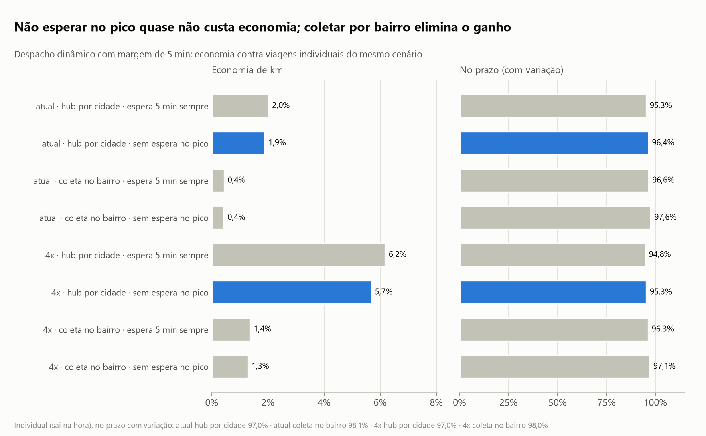

**8. Pela rua, o caminho é 37% maior que a linha reta.** Medido com o OSRM entre os 45 bairros, o fator real (1,37 de mediana, 1,71 em trechos curtos) é maior que o 1,3 usado no modelo. Com o fator calibrado, os km sobem cerca de 9%, mas a economia relativa e as conclusões se mantêm.

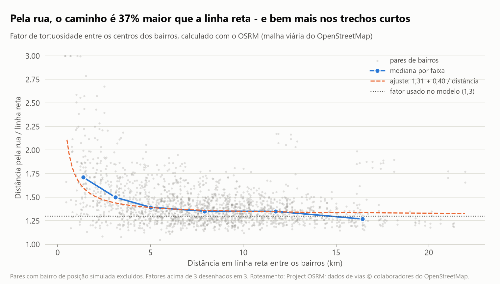

**9. No mapa, bairros com entregas mais longas tendem a atrasar mais** (bairros geocodificados pelo OpenStreetMap). Mapa interativo em `reports/mapa_bairros.html` (abrir no navegador).

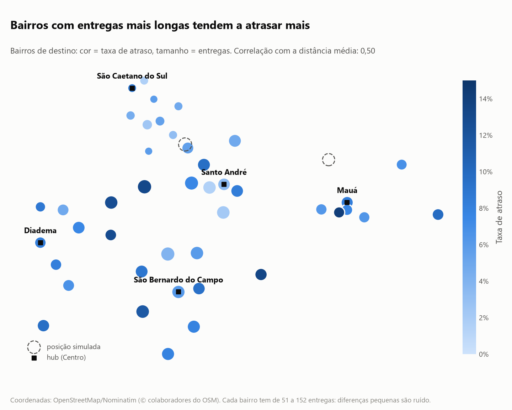

**10. Várias coletas na mesma viagem não resolvem sem hub** (notebook 10). Permitindo que a moto passe em restaurantes diferentes antes de entregar, só 0,6% das entregas viajam juntas no volume atual (1,7% com 4x), e a economia fica em 0,1% (0,5% com 4x). Com prazos de 20 a 35 minutos, o desvio e a parada extra no segundo restaurante não cabem. Só a coleta centralizada (hub) cria ganho relevante.

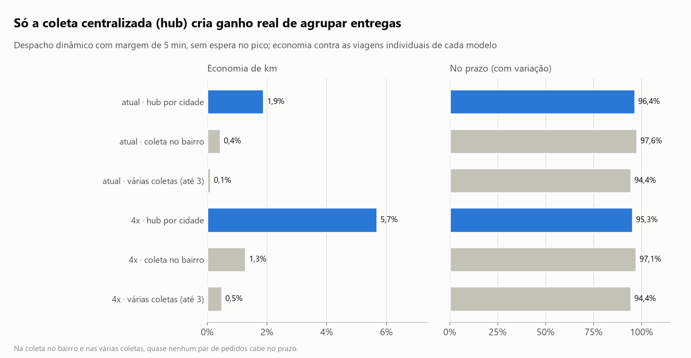
